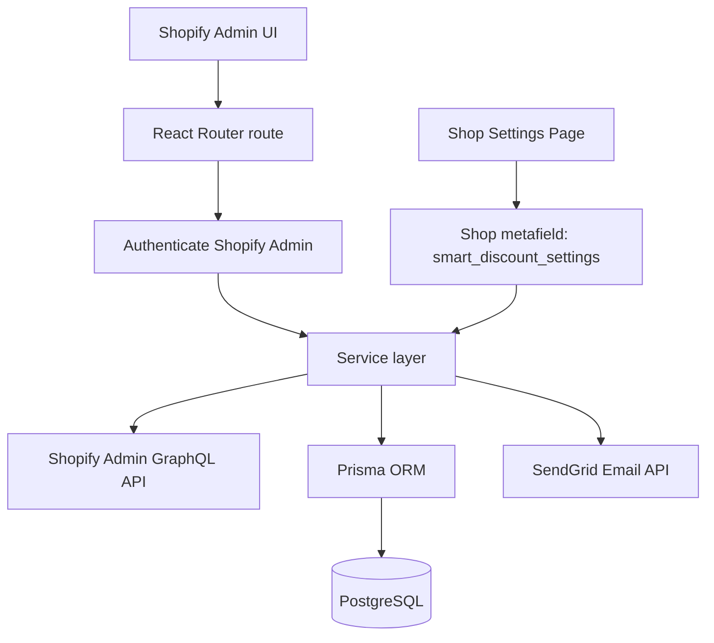
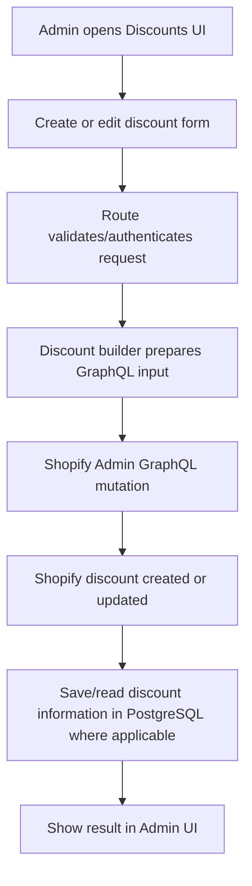
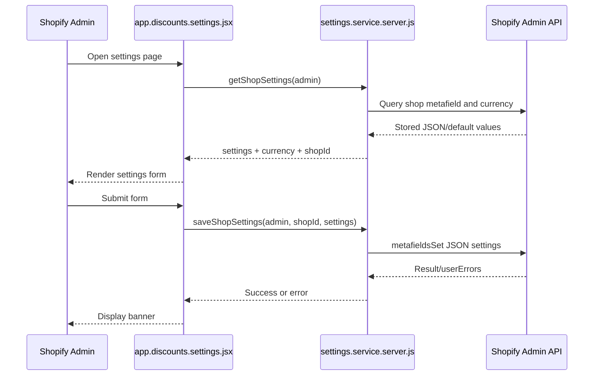
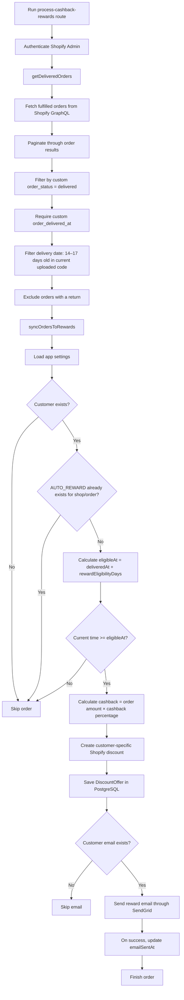

# Smart Discount Manager — Project Documentation

> **Purpose:** This document describes the current Smart Discount Manager codebase, its major features, architecture, and the end-to-end cashback reward flow. It is based on the uploaded project ZIP. Configuration values and implementation notes below describe the code found in that ZIP; verify them again after future code changes.

---

## 1. Project Overview

Smart Discount Manager is an embedded Shopify Admin app for creating and managing discount codes. It also includes an automated cashback-reward flow that identifies eligible delivered orders, creates a Shopify discount code for cashback, saves the discount information in PostgreSQL, and emails the customer.

### Main capabilities

1. Create, view, edit, activate/deactivate, and delete discount offers.
2. Store app settings in a Shopify **shop metafield**.
3. Fetch fulfilled Shopify orders and filter them using custom order-status and delivery-date metafields.
4. Calculate cashback for eligible orders.
5. Create a Shopify discount code restricted to the relevant customer.
6. Save cashback/discount information in PostgreSQL.
7. Send the customer an email containing the cashback code and expiry date.
8. Track whether a reward email was sent using `emailSentAt`.

### Technology stack

| Area | Technology |
|---|---|
| Shopify integration | Shopify Admin GraphQL API |
| App framework | React Router v7 / Shopify React Router app package |
| UI | React, Shopify Polaris |
| Database | PostgreSQL |
| ORM | Prisma |
| Email | SendGrid (`@sendgrid/mail`) |
| Settings storage | Shopify shop metafield, JSON type |
| Runtime | Node.js |

---

## 2. High-Level Architecture



### Main code locations

| File | Responsibility |
|---|---|
| `app/shopify.server.js` | Shopify app setup and authentication exports |
| `app/db.server.js` | Prisma client |
| `app/routes.js` | File-system route registration |
| `app/routes/app.discounts.settings.jsx` | Settings UI, loading, and saving settings |
| `app/services/settings.service.server.js` | Default settings and Shopify metafield read/write |
| `app/services/order.service.server.js` | Fetch Shopify orders and filter delivered orders |
| `app/routes/app.api.process-cashback-rewards.jsx` | Entry route that runs cashback processing |
| `app/services/reward.service.server.js` | Eligibility, duplicate checks, cashback calculation, and reward orchestration |
| `app/services/reward-coupon.service.server.js` | Creates the cashback discount in Shopify |
| `app/utils/reward-discount-builder.server.js` | Builds the Shopify discount input for cashback |
| `app/services/reward-discount-offer.service.server.js` | Saves the cashback discount offer in PostgreSQL |
| `app/services/reward-email.service.server.js` | Sends the cashback email using SendGrid |
| `app/services/shopify-discount.server.js` | Shopify discount create/update/activate/deactivate/delete operations for standard discounts |
| `app/services/discount-offers.server.js` | Reads discount offers from PostgreSQL |
| `prisma/schema.prisma` | Database models and constraints |
| `shopify.app.toml` | Shopify app settings, scopes, metafield definition, and webhook subscriptions |

---

## 3. Standard Discount Management Flow

The app also supports standard/manual discount management, separate from cashback rewards.



The service `app/services/shopify-discount.server.js` includes functions for creating, updating, activating, deactivating, and deleting Shopify discount codes. Input construction is delegated to the discount builder utilities.

---

## 4. Settings Management

### Where settings are stored

Settings are stored in a Shopify **shop metafield**:

- Namespace: `$app`
- Key: `smart_discount_settings`
- Type: `json`

The `getShopSettings(admin)` function in `app/services/settings.service.server.js` reads the shop currency and metafield. It merges stored JSON with `DEFAULT_SETTINGS`, so missing keys fall back to defaults.

The `saveShopSettings(admin, shopId, settings)` function writes the settings JSON using Shopify's `metafieldsSet` GraphQL mutation and throws an error if Shopify returns user errors.

### Default settings in the uploaded code

| Setting | Current default | Purpose |
|---|---:|---|
| `defaultDiscountType` | `PERCENTAGE` | Default type for standard discounts |
| `defaultDiscountStatus` | `ACTIVE` | Default status for standard discounts |
| `defaultDiscountCategory` | `ORDER` | Default category for standard discounts |
| `minimumPurchase` | `0` | Default minimum-purchase value |
| `cashbackPercentage` | `5` | Cashback percentage of the eligible order amount |
| `rewardEligibilityDays` | `14` | Days after delivery before the reward is eligible |
| `couponValidityDays` | `60` | Validity period for a generated cashback coupon |

**Important current-code note:** The uploaded settings page does **not** include `rewardGracePeriodDays` in its form/action, and `DEFAULT_SETTINGS` does not define it. The uploaded `order.service.server.js` still uses hardcoded `17` and `14` day boundaries. A dynamic grace-period change therefore needs to be implemented in the settings service, settings UI/action, and order service before it is available end-to-end.

### Settings request flow



---

## 5. Cashback Reward Flow — End to End

### Flow diagram



### Step-by-step details

#### Step 1 — Processing route

`app/routes/app.api.process-cashback-rewards.jsx` exposes a `loader` that:

1. Authenticates the Shopify Admin request.
2. Calls `getDeliveredOrders(admin)`.
3. Calls `syncOrdersToRewards(admin, session.shop, orders)`.
4. Returns a JSON result with counts (`inserted`, `skipped`, `failed`) or a 500 response on an outer error.

**Scheduling note:** In the uploaded code, this route is an executable processing endpoint. I did not find a cron/scheduler implementation that automatically calls it. A scheduled job or external scheduler would be needed if it must run automatically in production. Protect the processing endpoint appropriately; it should not be exposed as an unauthenticated public trigger.

#### Step 2 — Fetching orders

`app/services/order.service.server.js` queries Shopify orders with:

- GraphQL filter: `fulfillment_status:fulfilled`
- Page size: `first: 250`
- Cursor pagination while `hasNextPage` is true
- `custom.order_status` metafield
- `custom.order_delivered_at` metafield
- Return data (`returns(first: 1)`)
- Customer details and total order amount

After fetching pages, the code filters orders in JavaScript. An order must satisfy all of these conditions:

1. `custom.order_status` equals `delivered` (case-insensitive, whitespace trimmed).
2. `custom.order_delivered_at` exists and parses as a valid date.
3. Delivery date is between the computed minimum and maximum dates.
4. No return is found in the queried `returns` nodes.

**Current date range in the uploaded code:** 14 to 17 days old, using hardcoded offsets:
- Minimum date = today minus 17 days.
- Maximum date = today minus 14 days.

**Performance consideration:** Shopify is queried for fulfilled orders and then the delivery date is filtered in JavaScript. The code may fetch many pages before finding the 14–17 day orders. It does not currently restrict the Shopify query itself to the delivery metafield's date range.

#### Step 3 — Eligibility and duplicate checks

`app/services/reward.service.server.js` loads settings with `getShopSettings(admin)`.

Before creating a reward discount, it checks:

1. Customer ID exists; guest orders are skipped.
2. A cashback offer for this shop/order is not already present in the database.
3. Delivered date exists.
4. `rewardEligibilityDays` is a valid positive number.
5. The order has reached `deliveredAt + rewardEligibilityDays`.
6. Cashback percentage is a valid positive number.
7. Order amount and calculated cashback are valid.

The existing duplicate query uses `shop`, `source: AUTO_REWARD`, and the order IDs in the fetched batch. The schema also has `@@unique([shop, orderId])`, which provides a database-level uniqueness constraint for a shop/order pair.

**Important distinction:** The duplicate check prevents reprocessing when the corresponding database offer exists. If Shopify successfully creates a discount but the subsequent PostgreSQL insert fails, the Shopify discount may still exist without a matching database row. This cross-system failure needs recovery/reconciliation logic; a Prisma transaction cannot roll back a Shopify API mutation.

#### Step 4 — Cashback calculation

Current logic:

```js
cashbackAmount = Number(
  (orderAmount * (cashbackPercentage / 100)).toFixed(2)
);
```

With the default `cashbackPercentage: "5"`, the reward is 5% of the order total returned by Shopify's `totalPriceSet.shopMoney.amount`.

Examples:

| Order amount | Cashback at 5% |
|---:|---:|
| £100 | £5 |
| £200 | £10 |
| £500 | £25 |

The actual currency should be interpreted from the store/order currency; the email template currently displays a `£` symbol directly.

#### Step 5 — Shopify discount creation

`app/services/reward-coupon.service.server.js`:

1. Generates a coupon code using a timestamp suffix and random digits.
2. Builds the discount input through `buildCashbackDiscountInput(...)`.
3. Calls Shopify's `discountCodeBasicCreate` mutation.
4. Throws an error if the GraphQL payload is missing or Shopify returns `userErrors`.
5. Returns the Shopify discount ID, code, and expiry date.

The reward discount is intended to be a fixed-amount discount, restricted to the relevant customer, with a usage limit of one. Confirm the full builder in `app/utils/reward-discount-builder.server.js` if changing discount behavior.

#### Step 6 — Save the discount in PostgreSQL

`app/services/reward-discount-offer.service.server.js` creates a `DiscountOffer` record with:

- Shop
- Order ID and order name
- Customer ID, name, and email
- Cashback amount
- Delivered date and generated date
- Discount code and Shopify discount ID
- Source `AUTO_REWARD`
- Discount type/value and customer eligibility
- Start and end dates
- Usage limit and status

Coupon expiry is calculated from `couponValidityDays` in settings. The current default is 60 days.

There is no separate `Reward` model in the uploaded `prisma/schema.prisma`. Cashback tracking is represented by fields on `DiscountOffer`, including `source`, `orderId`, `cashbackAmount`, `generatedAt`, and `emailSentAt`.

#### Step 7 — Email sending

`app/services/reward-email.service.server.js` uses SendGrid and requires environment variables:

- `SENDGRID_API_KEY`
- `SENDGRID_FROM_EMAIL`
- `SENDGRID_FROM_NAME`

The email contains the customer's name, cashback amount, coupon code, and expiry date.

In `reward.service.server.js`, email sending is wrapped in a `try/catch`. If sending succeeds, `emailSentAt` is updated. If sending fails, the error is logged and the already-created discount offer is not deleted. If the customer email is missing, the email is skipped.

**Current limitation:** `emailSentAt` provides a basic success marker, but the uploaded code does not implement a dedicated retry queue or automated retry scheduler for failed emails. A retry mechanism should retry email delivery without creating another cashback discount.

---

## 6. Database Schema

The uploaded `prisma/schema.prisma` contains two main model/enum areas:

### `Session`

Used by Shopify app session storage. It stores shop/session identity and authentication/session fields.

### `DiscountOffer`

Stores both standard discount records and automatic cashback discount records.

Important fields:

| Field | Purpose |
|---|---|
| `shop` | Shopify shop identifier/domain |
| `discountCode` | Discount code; unique |
| `shopifyDiscountId` | Shopify discount ID; unique when non-null |
| `source` | `MANUAL` or `AUTO_REWARD` |
| `orderId` | Related Shopify order ID for cashback |
| `orderName` | Human-readable order name |
| `customerId`, `customerEmail`, `customerName` | Customer information |
| `cashbackAmount` | Calculated cashback amount |
| `deliveredAt` | Delivery date used for eligibility |
| `generatedAt` | When the cashback offer was generated |
| `emailSentAt` | When reward email successfully sent |
| `startDate`, `endDate` | Discount validity period |
| `status` | Discount status |
| `createdAt`, `updatedAt` | Audit timestamps |

Constraints/indexes:

- `id` is the primary key.
- `discountCode` is unique.
- `shopifyDiscountId` is unique.
- `@@unique([shop, orderId])` prevents duplicate shop/order records at database level.
- `@@index([shop])` supports shop-based lookup.

---

## 7. Current Settings and Logic — Important Consistency Notes

| Concern | Current uploaded-code behavior |
|---|---|
| Order date window | Hardcoded 14–17 days in `order.service.server.js` |
| Reward eligibility | Dynamic `settings.rewardEligibilityDays`, default 14 |
| Cashback rate | Dynamic `settings.cashbackPercentage`, default 5 |
| Coupon validity | Dynamic `settings.couponValidityDays`, default 60 |
| Grace period setting | Not implemented in the uploaded settings form/defaults |
| Duplicate prevention | Database lookup plus `@@unique([shop, orderId])` |
| Database transaction | No multi-write reward transaction currently required for the one `DiscountOffer` insert; external Shopify calls cannot be rolled back by Prisma |
| Email status | `emailSentAt` updated after successful email |
| Email retries | No dedicated automatic retry system found |
| Automatic scheduler | No cron implementation found in the uploaded code |
| Separate Reward table | Not present; reward data is stored in `DiscountOffer` |

### Why the date window and eligibility setting both matter

The order service first selects only orders delivered 14–17 days ago. The reward service then checks `deliveredAt + rewardEligibilityDays`.

If `rewardEligibilityDays` is changed to 20 but the order service remains hardcoded to 14–17 days, orders 20 days old will not reach reward processing. To make the date window configurable, add the appropriate settings (for example, eligibility days and grace-period days) to:
1. `DEFAULT_SETTINGS` in `settings.service.server.js`
2. The settings form and `action()` in `app/routes/app.discounts.settings.jsx`
3. `order.service.server.js`, which reads saved settings with `getShopSettings(admin)`

Do not use `request.formData()` in the order service. Form data exists only during settings form submission; order processing should read the persisted settings using `getShopSettings(admin)`.

---

## 8. Environment Variables and Deployment Notes

Configure secrets in the hosting provider's environment settings; do not commit actual secrets to source control.

Expected project configuration includes:

- `DATABASE_URL` — PostgreSQL connection string
- Shopify app credentials required by the Shopify app framework
- `SENDGRID_API_KEY`
- `SENDGRID_FROM_EMAIL`
- `SENDGRID_FROM_NAME`

Useful npm scripts from `package.json`:

```bash
npm run dev       # Local Shopify app development
npm run build     # Build React Router app
npm run start     # Run built app
npm run setup     # Generate Prisma Client and deploy migrations
npm run lint      # ESLint
npm run typecheck # React Router type generation and TypeScript check
npm run deploy    # Shopify app deploy/config workflow
```

Before production deployment:
1. Configure the production database and run migrations.
2. Configure Shopify app URL, redirect URLs, scopes, and webhook subscriptions.
3. Configure SendGrid sender/domain verification and environment variables.
4. Deploy the app to a persistent Node.js hosting service.
5. Configure a secured scheduled trigger if cashback processing must run automatically.
6. Add monitoring and reconciliation for Shopify-discount-created/database-save-failed cases.
7. Add email retry handling that does not regenerate the discount.

---

## 9. Recommended Operational Improvements

Priority order:

1. **Make the date window and reward eligibility settings consistent.** The current order filter is hardcoded to 14–17 days while eligibility is configurable.
2. **Add secure scheduling.** The processing route exists, but no automatic cron/scheduler was found in this ZIP.
3. **Add recovery for partial success.** Shopify discount creation and PostgreSQL persistence are separate systems; use logging/reconciliation rather than assuming a database rollback can undo Shopify.
4. **Add email retry processing.** Retry failed emails independently of cashback discount creation.
5. **Improve order-fetch performance.** Avoid fetching all fulfilled-order pages if the Shopify query can safely narrow the candidate set; delivery date is currently filtered in JavaScript.
6. **Validate settings before saving.** Enforce sensible numeric ranges for cashback percentage, eligibility days, coupon validity, and any future grace period.
7. **Review currency formatting.** The email template currently hardcodes `£`; use the appropriate currency from store/order data if multiple currencies are possible.
8. **Keep credentials out of Git.** Rotate any secrets that may have been included in a shared archive and use environment variables.

---

## 10. Quick Reference: Files to Open for Common Changes

| Task | File(s) |
|---|---|
| Change default cashback percentage | `app/services/settings.service.server.js` |
| Add a new settings field to the UI | `app/routes/app.discounts.settings.jsx` |
| Save/read shop settings | `app/services/settings.service.server.js` |
| Change which delivered orders are fetched | `app/services/order.service.server.js` |
| Change eligibility/duplicate/cashback orchestration | `app/services/reward.service.server.js` |
| Change cashback coupon input/code generation | `app/services/reward-coupon.service.server.js`, `app/utils/reward-discount-builder.server.js` |
| Change persisted cashback offer fields | `app/services/reward-discount-offer.service.server.js`, `prisma/schema.prisma` |
| Change reward email content/provider | `app/services/reward-email.service.server.js` |
| Run cashback processing endpoint | `app/routes/app.api.process-cashback-rewards.jsx` |
| Change standard discount GraphQL operations | `app/services/shopify-discount.server.js` and discount builder utilities |

---

## Summary

Smart Discount Manager has two related flows: standard Shopify discount management and automatic cashback rewards. The cashback process fetches fulfilled orders, filters by custom delivered status/date and return state, checks customer and duplicate eligibility, calculates cashback, creates a Shopify discount, stores it in PostgreSQL, and sends an email. Settings are stored as JSON in a Shopify shop metafield.

The most important current implementation caveats are that the order date window is still hardcoded to 14–17 days in the uploaded code, `rewardEligibilityDays` is independently configurable, `rewardGracePeriodDays` is not yet present in the uploaded settings, no automatic scheduler was found, and email retry/reconciliation are not implemented as dedicated workflows.
